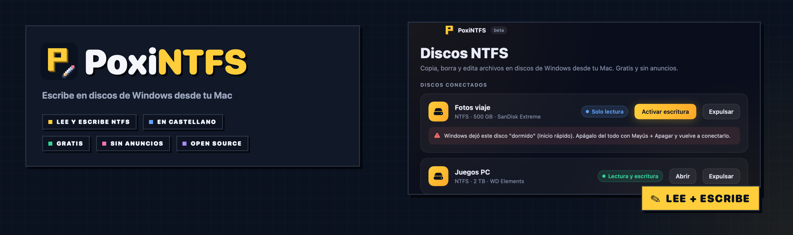
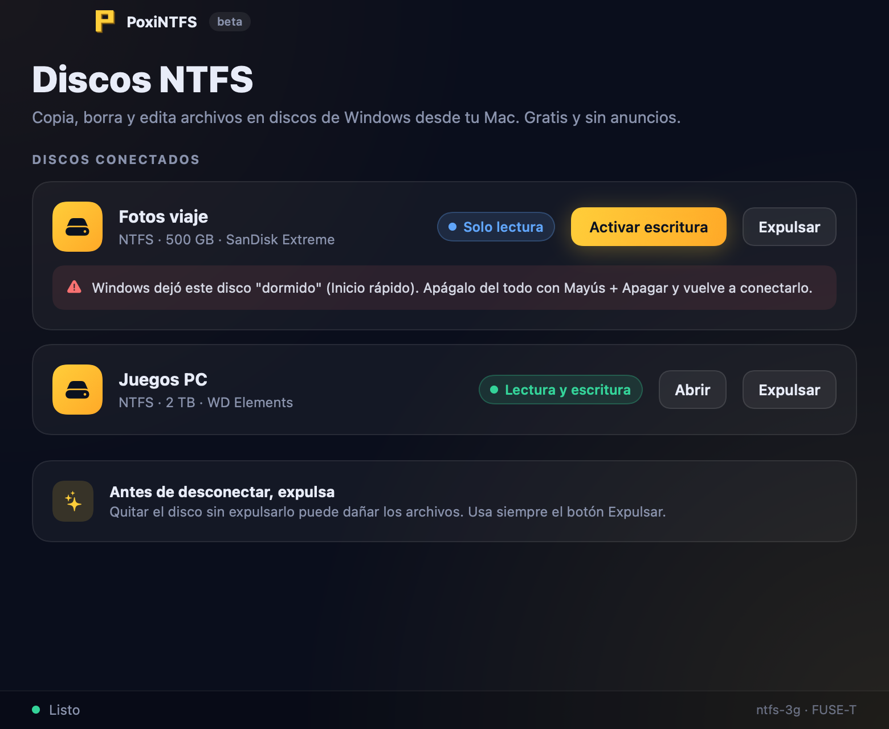
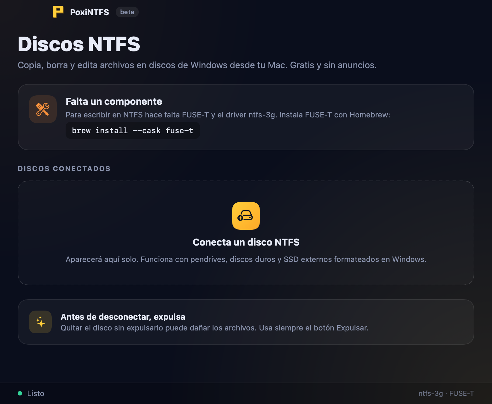

<div align="center">



<br />


**🇪🇸 Español** · [🇬🇧 English](#-english)

### Escribe en **discos de Windows** desde tu Mac, gratis y sin líos.

macOS lee los discos NTFS pero **no deja escribir** en ellos. Con PoxiNTFS conectas el disco,
pulsas **Activar escritura** y ya puedes copiar, borrar y editar archivos como en cualquier otro disco.

</div>

---

## 🎯 Qué es

**PoxiNTFS** es la alternativa gratuita y open source a las apps de pago tipo BuhoNTFS, Paragon o Tuxera.
Por dentro usa [**ntfs-3g**](https://github.com/tuxera/ntfs-3g), el driver NTFS libre de toda la vida, y
[**FUSE-T**](https://www.fuse-t.org), que lo conecta con macOS **sin extensiones del kernel** y sin tocar la
seguridad del Mac. Lo nuevo es todo lo que ves: la app, los avisos en castellano y el estilo de la familia Poxi.

## 📸 Así se ve

<table>
  <tr>
    <td width="50%"></td>
    <td width="50%"></td>
  </tr>
  <tr>
    <td align="center"><sub>💾 Tus discos NTFS, con su estado y un botón para activar la escritura</sub></td>
    <td align="center"><sub>🔌 Sin discos conectados, y el aviso si falta FUSE-T</sub></td>
  </tr>
</table>

## 📥 Descarga

| Archivo | Para qué |
|---|---|
| **[`PoxiNTFS-0.1.0.dmg`](https://github.com/PoxiiTV/PoxiNTFS/releases/download/v0.1.0/PoxiNTFS-0.1.0.dmg)** | **Instalador** (0,4 MB): ábrelo y arrastra PoxiNTFS a Aplicaciones |

Todas las versiones y sus novedades, en [**Releases**](https://github.com/PoxiiTV/PoxiNTFS/releases).

**Antes de usarla, instala FUSE-T** (una sola vez, te pide la contraseña del Mac):

```bash
brew install --cask fuse-t
```

> ℹ️ Como la app aún no está firmada por Apple, macOS la bloquea la primera vez. Ábrela, cierra el aviso y ve a
> **Ajustes del Sistema → Privacidad y seguridad → Abrir igualmente**. Solo hace falta una vez.

---

## 🌟 Lo que la hace distinta

| | |
|---|---|
| 💸 **Gratis de verdad** | Sin pruebas de 7 días, sin licencias y sin anuncios. El código está aquí |
| 🔌 **Sin extensiones del kernel** | Usa FUSE-T, así que no tienes que reiniciar en modo recuperación ni bajar la seguridad del Mac |
| 🧠 **Avisos que se entienden** | Si Windows dejó el disco «dormido» (Inicio rápido) o sin cerrar bien, te dice qué pasa y cómo arreglarlo, en castellano |
| 🧹 **Sin basura en tus discos** | No crea los archivos `._` de macOS, que luego aparecen en Windows |
| 🪟 **Compatible con Windows** | No deja crear nombres de archivo que Windows no sabe abrir (con `:`, `?`, `*`…) |
| ⏏️ **Expulsar con seguridad** | Un botón para desmontar y expulsar; si algo está usando el disco, te avisa en vez de romperlo |
| 📍 **En la barra de menú** | Activa la escritura o expulsa sin abrir la ventana |
| 📦 **Todo dentro** | El driver ntfs-3g va dentro de la app; solo necesitas FUSE-T |

## 🚀 Cómo se usa

1. Conecta el disco NTFS. Aparece solo en PoxiNTFS, en **Solo lectura**.
2. Pulsa **Activar escritura** y escribe la contraseña del Mac.
3. Cuando pase a **Lectura y escritura**, pulsa **Abrir** y úsalo como cualquier disco.
4. Antes de desconectarlo, pulsa **Expulsar**.

## ⚠️ Avisos

- 🧪 **Es una beta.** Se ha probado a fondo con discos NTFS virtuales, todavía poco con discos físicos.
  Haz copia de lo importante antes de escribir en un disco.
- 🔑 Pide la **contraseña del Mac cada vez** que activas la escritura: montar un disco necesita permisos de administrador.
- 💤 Si el disco viene de un Windows con **Inicio rápido**, apágalo del todo con **Mayús + Apagar** antes de conectarlo al Mac.
- 🐢 Va por FUSE, así que es algo más lento que los drivers de pago para archivos muy grandes.
- 🍎 De momento solo para Macs con **Apple Silicon** (M1 o posterior) y macOS 14 o superior.

---

## 🔧 Compilar

Requiere las Command Line Tools de Xcode, Homebrew y FUSE-T.

```bash
brew install autoconf automake libtool pkgconf gettext libgcrypt
curl -LO https://github.com/tuxera/ntfs-3g/archive/refs/tags/2026.9.28.tar.gz && tar xzf 2026.9.28.tar.gz
scripts/build-ntfs3g.sh ntfs-3g-2026.9.28 ~/.poxintfs/ntfs-3g   # driver (ruta sin espacios)
scripts/make-app.sh                                            # build/PoxiNTFS.app con el driver dentro
scripts/make-dmg.sh                                            # build/PoxiNTFS-<versión>.dmg
```

Para probar sin abrir la ventana: `build/PoxiNTFS --scan`, `--enable <disco>` y `--eject <disco>`.

### 🗃️ Estructura

```
Sources/PoxiNTFS/   la app: detección de discos, montaje, interfaz y barra de menú
scripts/            compilar ntfs-3g, la app, el instalador, el icono y el banner
.assets/            banner, icono y capturas del README
```

Las novedades, en [`CHANGELOG.md`](CHANGELOG.md).

## 🙏 Gracias a

- [**ntfs-3g**](https://github.com/tuxera/ntfs-3g) (Tuxera y colaboradores): todo el mérito de leer y escribir NTFS es suyo.
- [**FUSE-T**](https://www.fuse-t.org): la pieza que permite usarlo en macOS sin extensiones del kernel.

## 📜 Licencia

PoxiNTFS es software libre bajo **[GPL-3.0](LICENSE)**. Incluye ntfs-3g (GPL-2.0-or-later); los detalles y su
código fuente están en [`THIRD-PARTY.md`](THIRD-PARTY.md).

---

## 🇬🇧 English

<div align="center">

### Write to **Windows drives** from your Mac, free and hassle-free.

</div>

## 🎯 What it is

macOS can read NTFS drives but **can't write** to them. **PoxiNTFS** is a free, open source alternative to paid
apps like BuhoNTFS, Paragon or Tuxera: plug in the drive, press **Activar escritura** (enable writing) and copy,
delete and edit files as usual. Under the hood it uses [**ntfs-3g**](https://github.com/tuxera/ntfs-3g) and
[**FUSE-T**](https://www.fuse-t.org), so **no kernel extensions** and no lowered security. The interface is in Spanish.

## 📥 Download

| File | What for |
|---|---|
| **[`PoxiNTFS-0.1.0.dmg`](https://github.com/PoxiiTV/PoxiNTFS/releases/download/v0.1.0/PoxiNTFS-0.1.0.dmg)** | **Installer** (0.4 MB): open it and drag PoxiNTFS to Applications |

Install FUSE-T first: `brew install --cask fuse-t`.

> ℹ️ The app is not signed by Apple yet, so macOS blocks it the first time. Open it, close the warning and go to
> **System Settings → Privacy & Security → Open Anyway**.

## 🌟 Highlights

- 💸 **Actually free**: no trials, no licenses, no ads.
- 🔌 **No kernel extensions**, thanks to FUSE-T.
- 🧠 **Clear warnings** when Windows left the drive hibernated (Fast Startup) or not cleanly closed.
- 🧹 **No `._` files** left on your drives, and **Windows-safe file names**.
- ⏏️ **Safe eject**, plus a **menu bar** icon.

## ⚠️ Notices

- 🧪 **Beta**: thoroughly tested with virtual NTFS disks, still lightly with physical ones. Back up first.
- 🔑 Asks for your **Mac password every time** you enable writing.
- 🍎 **Apple Silicon** and macOS 14+ only for now.

## 📜 License

Free software under **[GPL-3.0](LICENSE)**. Bundles ntfs-3g (GPL-2.0-or-later); details and source in
[`THIRD-PARTY.md`](THIRD-PARTY.md).
